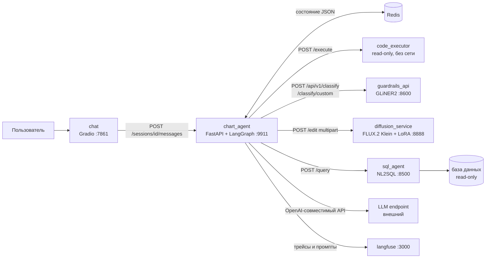

# NL2G — Natural Language to Graphic

Вопрос на русском → SQL к базе → график → генеративная правка картинки → LLM-оценка.
Объединение двух дипломных систем: NL2SQL-агент с LoRA-ролями (`sql_agent/`) и агентная
генерация и правка графиков (`chart_agent/`, `diffusion_service/`, `guardrails_api/`, `chat/`).

Быстрый старт — `QUICKSTART.md`, сценарий показа — `DEMO.md`, как устроена интеграция —
`INTEGRATION_SQL_SOURCE.md`. Конфигурация: скопируйте `*/.env.example` в `*/.env`.
Замеры на русских данных PAUQ и отчёты — в `sql_agent/` (см. `sql_agent/README.md`).

---

# Агентная система построения и генеративного редактирования графиков

Микросервисная реализация системы из ВКР (раздел 5.3). Здесь только рабочая
система и её зависимые сервисы — экспериментальный код, датасеты и бенчмарки
в папку не входят.

Этот документ — точка входа: что делает система, из чего состоит, как связаны
сервисы, как запустить и в каком она состоянии. Детали каждого сервиса — в его
собственном README (по одному на сервис, других документов нет).

## 1. Что делает система

Пользователь в чате описывает график словами или загружает таблицу. Система
извлекает данные, генерирует код построения, рисует график и показывает его на
подтверждение. Подтверждённый график можно отправить на генеративное
визуальное улучшение диффузионной моделью — с автоматической оценкой результата
и повторными итерациями, пока качество не устроит.

Ключевая идея — **гибридный подход**: базовая визуализация строится программно
(это гарантирует аналитическую корректность), а модель генерации применяется
только на этапе визуального улучшения уже построенного графика. Прямая генерация
графика диффузией даёт красивую, но недостоверную картинку; здесь этого нет.

Второй сквозной принцип — **LLM решает «как», код делает «что»**. Модель не
рисует и не считает: она генерирует `matplotlib`- и `pandas`-код, а исполняет его
детерминированный executor в изолированном контейнере.

## 2. Состав

| Сервис | Папка | Порт | Роль | GPU |
| --- | --- | --- | --- | --- |
| Chart Agent | [chart_agent/](chart_agent/) | 8000, 9911 | Оркестратор: FastAPI + LangGraph, агенты, состояние сессии | — |
| Code Executor | [chart_agent/code_executor/](chart_agent/code_executor/) | 8080 (internal) | Изолированное исполнение сгенерированного кода | — |
| Redis | в `chart_agent/docker-compose.yml` | 6379 (internal) | Состояние сессии в виде JSON | — |
| GuardRails API | [guardrails_api/](guardrails_api/) | 8600 | GLiNER2: фильтр небезопасного ввода + zero-shot классификация интента | опц. |
| SQL Agent | [sql_agent/](sql_agent/) | 8500 | NL2SQL: вопрос на естественном языке → таблица из базы | — |
| Diffusion Edit | [diffusion_service/](diffusion_service/) | 8888 | Генеративное редактирование: FLUX.2 [Klein] 9B + LoRA | **да** |
| Gradio-чат | [chat/](chat/) | 7861 | Веб-интерфейс пользователя | — |
| Langfuse | [langfuse/](langfuse/) | 3000 | Трассировка пайплайна и версионирование промптов | — |

Разделение на сервисы сделано, чтобы изолировать компоненты с разной
вычислительной нагрузкой: тяжёлый GPU-инференс не должен быть связан с лёгким
оркестратором, а быстрый классификатор — зависеть от состояния основного
приложения.



## 3. Как проходит запрос

**Построение графика.** Сообщение приходит в `chart_agent` → проверка ввода
в `guardrails_api` → агент `interaction` определяет ветку (быстрый zero-shot
классификатор, при низкой уверенности — LLM) → извлечение данных из текста,
обработка загруженной таблицы или запрос в `sql_agent` за таблицей из базы →
подготовка данных сгенерированным pandas-кодом → генерация `matplotlib`-кода →
исполнение в `code_executor` → PNG возвращается пользователю с запросом
подтверждения. Состояние сессии на каждом шаге пишется в Redis, все шаги
трассируются в Langfuse.

**Генеративное редактирование.** Подтверждённый график (или загруженное
изображение) → выбор входного изображения → улучшение промпта отдельным
LLM-шагом → `POST /edit` в `diffusion_service` → оценка результата
агентом-критиком → при низком score новая итерация с учётом замечаний. Система
хранит лучший вариант и переносит принятое изображение между ходами диалога.

**Данные из базы.** Третий источник наравне с текстом и CSV. Пользователь
включает в интерфейсе «Данные из базы», вопрос уходит в `sql_agent`, тот
выполняет NL2SQL-конвейер (схемотехник → программист → критик с execution
feedback) и возвращает сырую таблицу. Дальше — обычный табличный путь. SQL и
его пояснение показываются под графиком: цифры из базы, которых пользователь не
видел, проверяемы только вместе с запросом.

Детально: [chart_agent/README.md](chart_agent/README.md) — граф, агенты, контракты API.

## 4. Внешние зависимости

Ни один compose-файл их не поднимает:

- **LLM endpoint** — любой OpenAI-совместимый сервер (`OPENAI_API_BASE`).
  В работе использовалась локально развёрнутая Qwen3.5 9B.
- **Веса моделей** — FLUX.2 [Klein] 9B (~18 ГБ, gated, нужен `HF_TOKEN`) и
  GLiNER2 для guardrails. Скачиваются в кеш HF, который монтируется в контейнеры.

## 5. Запуск

Порядок важен: оркестратор при старте проверяет доступность LLM.

```bash
# 1. Мониторинг и промпты
cd langfuse && docker compose up -d

# 2. Классификатор (в .env стоит PROFILE=cpu; GPU: make up PROFILE=gpu)
cd ../guardrails_api && make up

# 3. Сервис генерации (на GPU-хосте; нужен HF_TOKEN для весов FLUX)
cd ../diffusion_service && HF_TOKEN=hf_... docker compose up --build -d

# 4. SQL-агент (опционально; сначала ролевые модели с LoRA)
cd ../sql_agent && make ollama-lora && docker compose up --build -d

# 5. Оркестратор + Redis + code executor
cd ../chart_agent && docker compose up --build -d

# 6. Интерфейс
cd ../chat && docker compose up --build
```

Интерфейс: http://localhost:7861 · Langfuse UI: http://localhost:3000 ·
OpenAPI оркестратора: http://localhost:8000/docs

### Что проверить в `.env` перед запуском

- **`chart_agent/.env`** — `OPENAI_API_BASE` (адрес LLM), `EDIT_SERVICE_URL` и
  `DIFFUSION_HOST` (адрес GPU-хоста с `diffusion_service`), ключи Langfuse.
- **Guardrails включены** (`GUARDRAILS_ENABLED=true`) и ожидают сервис на
  `host.docker.internal:8600`. Если поднимать оркестратор без классификатора,
  поставьте `false`: при `GUARDRAILS_FAIL_OPEN=true` система деградирует на
  LLM-маршрутизацию сама, но каждый запрос будет ждать таймаут.
- **`LANGFUSE_PROMPTS_ENABLED=false`** — промпты берутся из `chart_agent/app/prompts/`.
  Чтобы вести их из Langfuse (как описано в ВКР), сначала синхронизируйте:
  `chart_agent/scripts/sync_langfuse_prompts.py --push`, затем поставьте `true`.
  Без синхронизации включать нельзя: две версии в Langfuse отстали от кода
  (подробности — в README оркестратора, п.12).
- **`EDIT_USE_STUB=false`** — иначе вместо генерации вернётся заглушка.
- **`SQL_AGENT_ENABLED=false`** по умолчанию: без сервиса система ведёт себя
  ровно как раньше. Включив, проверьте `SQL_AGENT_URL` и то, что подняты три
  ролевые модели (`ollama list | grep nl2sql`).
- **`guardrails_api/.env`** — `PROFILE=cpu|gpu` и пороги срабатывания. В compose
  выставлен `HF_HUB_OFFLINE=1`, поэтому веса нужно скачать заранее:
  `make download-model`.

## 6. Состояние системы

Тесты есть у оркестратора и у SQL-агента:

```bash
cd chart_agent && make unit   # 38 проходят
cd sql_agent   && make test   # 58 проходят
```

Из 38 тестов оркестратора 21 покрывает ветку данных из базы: маршрутизация трёх
источников, повторное использование строк при правке графика, поведение при
недоступности сервиса, обрезка выборки, откат.

Баг `infer_column_type` с четырёхзначными числами, описанный в более ранней
версии этого документа, **исправлен**: `_DATE_PATTERN` больше не содержит
альтернативу для голого четырёхзначного числа, годы ловит отдельная эвристика,
на оба случая есть регрессионные тесты. Для данных из базы вопрос снят иначе —
типы приходят от СУБД и эвристика на этом пути не задействуется.

Прочее, о чём стоит знать: pandas-код исполняется внутри процесса API (в отличие
от chart-кода, изолированного контейнером); в графе осталась неподключённая
ветка edit-роутеров от предыдущей итерации; в enum стадий есть legacy-значения.

## 7. Документация

Один документ на сервис, дублей нет:

| Документ | О чём |
| --- | --- |
| [QUICKSTART.md](QUICKSTART.md) | Пошаговый запуск всей сборки и что попробовать в первую очередь |
| [chart_agent/README.md](chart_agent/README.md) | Оркестратор целиком: слои, граф, агенты, API, IR, исполнение кода, конфигурация, тесты |
| [guardrails_api/README.md](guardrails_api/README.md) | Задачи и метки классификатора, оба эндпоинта, пороги, внутреннее устройство |
| [diffusion_service/README.md](diffusion_service/README.md) | Модели и веса, LoRA-адаптер и его обучение, API `/edit` |
| [sql_agent/README.md](sql_agent/README.md) | NL2SQL-сервис: три роли и LoRA, контракт `/query`, безопасность |
| [chat/README.md](chat/README.md) | Gradio-интерфейс и его поведение |

У `langfuse/` своего README нет: это стандартный `docker-compose.yml` из
официальной поставки Langfuse v3 плюс `.env` с портами и ключами.

Отдельно лежит [INTEGRATION_SQL_SOURCE.md](INTEGRATION_SQL_SOURCE.md) — разбор
подключения SQL-агента как третьего источника данных: точка врезки, контракт,
список изменений в оркестраторе, риски и оставшиеся открытые вопросы. Вариант А
из этого документа реализован; таблица соответствия — в его §0.

## 8. Соответствие тексту ВКР

| В ВКР | Здесь |
| --- | --- |
| Центральный сервис на FastAPI с пайплайном на LangGraph | `chart_agent` |
| Состояние сессии в Redis в виде JSON | `chart_agent/docker-compose.yml`, `chart_agent/app/api/state_store.py` |
| Веб-интерфейс отдельным сервисом на Gradio | `chat` |
| Исполнение сгенерированного кода в отдельном контейнере | `chart_agent/code_executor` |
| Сервис GLiNER2: фильтр ввода + классификация интента | `guardrails_api` |
| Сервис генерации с LoRA-адаптером | `diffusion_service` |
| Langfuse: трассировка и управление промптами | `langfuse` |
| FLUX.2 [Klein] 9B как итоговая модель генерации | `black-forest-labs/FLUX.2-klein-9B` |
| LoRA ранга 16, чекпоинт 2000, выбран по SSIM/LPIPS | `diffusion_service/lora/flux2_klein_chart_edit_rank16_step2000/` |

Сверх текста ВКР: `sql_agent` — третий источник данных из второй работы
(NL2SQL, мульти-агентный конвейер с LoRA на роли). См.
[INTEGRATION_SQL_SOURCE.md](INTEGRATION_SQL_SOURCE.md).
