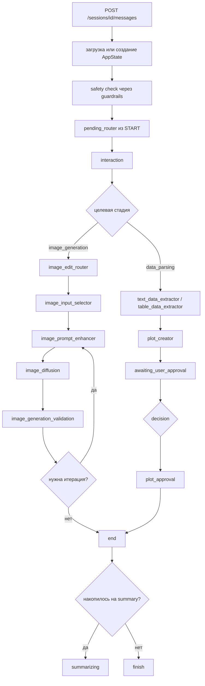

# Chart Agent

Stateful backend-оркестратор диалогового построения графиков и генеративного
редактирования изображений. `FastAPI` + `LangGraph`, состояние сессии в Redis,
исполнение сгенерированного кода — в отдельном контейнере.

Это единственный документ по сервису: архитектура, контракты, конфигурация,
известные проблемы. Общая картина всей системы — в [../README.md](../README.md).

## 1. Что это и зачем

Система принимает сообщения через HTTP, хранит состояние сессии, маршрутизирует
запрос через граф, использует LLM-агентов для решений и извлечения структуры, а
затем выполняет детерминированные шаги: обработку таблиц, генерацию
`matplotlib`-кода, рендер и вызов внешнего сервиса генерации изображений.

Два пользовательских контура:

1. построение графика по тексту или загруженной таблице;
2. генеративное редактирование изображения (построенного графика или загруженного).

Плюс: правка уже построенного графика, подтверждение результата пользователем,
краткая память диалога через summary, guardrails-фильтрация и быстрая
классификация интента, rollback до поддерживаемых стадий.

Базовый принцип разделения:

```text
state   = источник истины
graph   = orchestration
agents  = reasoning и structured extraction
tools   = deterministic execution
API     = transport и session boundary
```

Три слоя, в которые должны укладываться дальнейшие изменения:

| Слой | Отвечает за | Основные файлы |
| --- | --- | --- |
| Orchestration | состояние, переходы, ожидание пользователя, rollback, lifecycle артефактов | `app/graph/state.py`, `app/graph/pipeline.py`, `app/graph/invalidation.py`, `app/api/routes_sessions.py` |
| Agent reasoning | маршрутизация, извлечение структуры, генерация кода, оценка результата | `app/agents/*`, `app/prompts/*`, `app/graph/node_schemas/*` |
| Deterministic execution | HTTP, хранение, обработка таблиц, рендер, вызовы внешних сервисов | `app/tools/*`, `app/infra/*`, `app/api/state_store.py`, `code_executor/` |

## 2. Структура проекта

```text
app/
  api/
    routes_sessions.py     # единственный роутер: /sessions/*
    schemas.py             # внешние контракты + внутренний IR
    presenter.py           # сборка ответа
    state_store.py         # in-memory + Redis
  graph/
    state.py               # AppState
    pipeline.py            # StateGraph: ноды и рёбра
    routing.py             # функции-роутеры
    invalidation.py        # rollback и очистка downstream-состояния
    nodes/                 # реализация нод
    node_schemas/          # pydantic-контракты ответов агентов
  agents/                  # LLM-агенты + registry + contracts
  prompts/                 # промпты с локальным fallback
  tools/                   # детерминированная обработка данных и рендер
  infra/
    llm/client.py          # OpenAI-совместимый клиент
    guardrails/client.py   # клиент guardrails_api
    langfuse_prompts.py    # загрузка промптов из Langfuse
    tracing.py             # спаны Langfuse
  domain.py                # StageName
  main.py
code_executor/             # отдельный сервис исполнения кода (свой Dockerfile)
scripts/                   # вспомогательные скрипты, не часть рантайма
tests/
```

## 3. API

| Метод | Путь | Назначение |
| --- | --- | --- |
| `POST` | `/sessions` | создать пустую сессию |
| `POST` | `/sessions/{session_id}/messages` | отправить сообщение или decision |
| `POST` | `/sessions/{session_id}/rollback` | откатить состояние на стадию |
| `GET` | `/sessions/{session_id}` | получить текущее состояние |

Особенности контракта:

- система session-based, а не stateless request/response;
- сессия создаётся лениво: первое сообщение в новый `session_id` создаёт состояние;
- при `awaiting_user_approval=true` backend принимает только decision;
- обычные `"approve"`, `"ok"`, `"да"` автоматически нормализуются в decision;
- ответ содержит не только `assistant_message`, но и `artefacts` — результат работы пайплайна.

Почти вся бизнес-логика запускается из `POST /sessions/{id}/messages`; API — тонкая
граница транспорта, а не бизнес-движок.

### Формат запроса

```json
{ "type": "message",  "content": "Построй bar chart с A=10 B=20 C=15", "images_base64": [] }
{ "type": "decision", "value": "approve", "content": "", "images_base64": [] }
```

Дополнительно для image-ветки: `auto_validate_enabled`, `generation_seed`.

Изображения ходят в base64: вход — `images_base64`; результат — `artefacts.plot.image_base64`
(построенный график) и `artefacts.image.image_base64` (сгенерированное изображение).

### Формат ответа

`session_id`, `current_stage`, `ephemeral_status`, `assistant_message`, `artefacts`.

`artefacts` состоит из трёх блоков — результат хранится не как финальный ответ, а как
набор промежуточных доменных артефактов, пригодных для переиспользования и правки:

- `data` — извлечённые данные (`DatasetSpec`, `ChartIntent`) и отчёт валидации;
- `plot` — `code`, `image_base64`, `approved`, `chart_attempt`, `evaluation`;
- `image` — метаданные итераций генерации, лучший вариант, accepted image.

### Примеры

```bash
# создать сессию
curl -X POST http://localhost:8000/sessions

# построить график из текста
curl -X POST http://localhost:8000/sessions/<SID>/messages \
  -H 'Content-Type: application/json' \
  -d '{"type":"message","content":"Построй столбчатую диаграмму A=10 B=20 C=15"}'
# → current_stage=plot_rendering, график в artefacts.plot.image_base64,
#   система просит подтвердить или прислать правки

# подтвердить
curl -X POST http://localhost:8000/sessions/<SID>/messages \
  -H 'Content-Type: application/json' -d '{"type":"decision","value":"approve"}'

# генеративное редактирование
curl -X POST http://localhost:8000/sessions/<SID>/messages \
  -H 'Content-Type: application/json' \
  -d '{"type":"message","content":"Улучши это изображение графика","images_base64":["<B64>"]}'

# откат
curl -X POST http://localhost:8000/sessions/<SID>/rollback \
  -H 'Content-Type: application/json' -d '{"target_stage":"ingress"}'
```

## 4. Состояние и стадии

Центральный объект — `AppState` (`app/graph/state.py`): id сессии, текущая/предыдущая/
следующая стадия, флаг ожидания решения пользователя, пользовательский ввод, CSV,
изображения, summary, trace id, ошибки, ephemeral status, артефакты, routing-флаги.

Стадии (`app/domain.py`):

| Стадия | Смысл |
| --- | --- |
| `ingress` | старт и маршрутизация запроса |
| `data_parsing` | извлечение данных и валидация под построение |
| `sql_query` | ожидание таблицы от `sql_agent` (данные из базы) |
| `plot_rendering` | генерация кода и рендер графика |
| `plot_approval` | график подтверждён пользователем |
| `image_generation` | ветка генеративного редактирования |
| `error` | ошибка маршрутизации или выполнения |
| `chart_review`, `chat` | legacy-значения enum, не пользовательский маршрут |

Rollback поддерживается на `ingress`, `data_parsing`, `plot_rendering`, `chart_review`
(`app/graph/invalidation.py`). Семантика: переход на стадию, частичная очистка
downstream-состояния, дальнейшее выполнение обычным workflow.

## 5. Граф

`app/graph/pipeline.py` собирает `StateGraph(AppState)`.



Зарегистрированные ноды: `interaction`, `text_data_extractor`, `table_data_extractor`,
`sql_source`,
`plot_creator`, `plot_approval`, `image_edit_router`, `image_input_selector`,
`image_prompt_enhancer`, `image_diffusion`, `image_generation_validation`,
`summarizing`, `error`, `end`.

Точку входа выбирает `pending_router` (`nodes/pending_node.py`) — это не нода, а
conditional edge из `START`: по текущей стадии решает, продолжить ожидающий сценарий
или начать с `interaction`.

**Retry — часть orchestration, а не логика внутри агентов:** LLM-ноды повторяются при
`LLMServiceUnavailableError`, diffusion-нода — при `httpx.HTTPError`.

После `end` система переходит в `summarizing`, только если накопилось достаточно
сообщений; иначе выполнение завершается сразу.

> `nodes/edit_router_node.py` и `nodes/chart_edit_router_node.py` вместе с
> `EditRouterAgent` / `ChartEditRouterAgent`, их промптами и схемами **в граф не
> подключены** — ни одного импорта из `pipeline.py`. Это ветка предыдущей итерации;
> правки сейчас маршрутизирует `interaction`.

## 6. Агенты

Ключи реестра (`app/agents/registry.py`) → классы:

| Роль | Класс | Ноды | Отвечает за |
| --- | --- | --- | --- |
| `interaction` | `InteractionAgent` | `interaction_node` | понять намерение, выбрать ветку (`data_parsing` / `image_generation`), ответить или уточнить |
| `data_understanding` | `DataParserAgent` | `data_node`, `table_node` | извлечь данные, валидировать, спланировать и сгенерировать код обработки таблицы |
| `plot_planner` | `ChartCoderAgent` | `plot_node` | сгенерировать `matplotlib`-код в JSON-контракте |
| `image_edit_router` | `ImageEditRouterAgent` | `image_edit_router_node` | взять новое изображение или переиспользовать `last_accepted_image_base64` |
| `image_critic` | `ImageGenerationValidatorAgent` | `image_generation_validation_node` | сравнить исходное и сгенерированное, вернуть score и feedback |
| `summary` | `SumUpAgent` | `summarizing_node` | сжать историю в рабочий контекст |

Важные свойства:

- **`interaction` сначала пробует guardrails.** Быстрая zero-shot классификация интента;
  в LLM уходит, только если confidence ниже `GUARDRAILS_CONFIDENCE_THRESHOLD`.
- **`plot_planner` не рисует.** Он генерирует код; рисует детерминированный executor.
  LLM отвечает за «как построить», Python — за «построить реально».
- **`data_understanding` совмещает несколько режимов** (`parser`, `validator`,
  `table_planner`, `table_code_generator`) — роль одна, контрактов reasoning внутри
  несколько.
- **`summary` — производное сжатие истории, а не источник истины.** Источник истины — `AppState`.

## 7. Ветка построения графика

Источников данных три, и все они сходятся в одном месте — `plot_creator`.
Развилку выбирает `route_after_interaction`: явный запрос данных из базы
(переключатель в интерфейсе, поле `use_sql_source`) выигрывает у загруженного
CSV, потому что переключатель — осознанное действие пользователя, а CSV мог
остаться от предыдущего хода.

**Путь через базу:** `interaction` → `sql_source` → `table_data_extractor` →
`plot_creator`. Нода `sql_source` (`app/graph/nodes/sql_source_node.py`) ходит в
[../sql_agent](../sql_agent/) и кладёт полученные `columns` + `rows` в
состояние; дальше работает обычный табличный путь. Три свойства этой ветки
стоит держать в голове:

- **fail-open не применяется.** Без данных строить нечего, поэтому недоступность
  сервиса — это `error` с честным сообщением, а не тихая деградация.
- **Правка не ходит в базу повторно.** `persisted_sql_result` переживает ход
  диалога, и «а теперь линией» перестраивает график по уже полученным строкам:
  иначе цифры под графиком могли бы молча измениться.
- **Типы колонок приходят от СУБД** и переопределяют `infer_column_type` —
  на этом пути угадывать тип по значениям не нужно.

**Текстовый путь:** `interaction` → `text_data_extractor` → `plot_creator` →
ожидание подтверждения → `plot_approval` либо правка. В `data_node` агент сначала
строит результат извлечения, затем отдельно выполняет валидацию; при нехватке данных
система не падает в `error`, а уходит в уточняющий вопрос.

**Табличный путь:**

1. `parse_table()` детерминированно читает CSV/TSV;
2. строится компактный контекст таблицы;
3. LLM генерирует pandas-код (`TableCodeSpec`);
4. код исполняется в ограниченной среде;
5. DataFrame превращается в `DatasetSpec` + `ChartIntent`;
6. дальше обычный `plot_creator`.

Ключевое решение: вместо жёсткого enum-плана для таблиц выбран codegen — для
небольших моделей pandas-код оказался надёжнее сложного структурного JSON-плана.

**Human-in-the-loop** — часть доменной модели, а не UI-деталь: после рендера
выставляется `awaiting_user_approval=true`, пользователь может подтвердить,
прислать правку или отменить.

## 8. Ветка генеративного редактирования

`interaction` → `image_edit_router` → `image_input_selector` → `image_prompt_enhancer`
→ `image_diffusion` → `image_generation_validation` → цикл или завершение.

- входным изображением может быть новое изображение пользователя, предыдущая принятая
  генерация или построенный график;
- промпт перед генерацией переписывается отдельным шагом (PromptEnhancer);
- валидация включена по умолчанию, отключается флагом;
- система хранит лучший вариант и score по итерациям;
- принятое изображение переносится между ходами диалога.

Это полноценный iterative generate-critic loop, а не разовый вызов модели.
Запрос уходит в `../diffusion_service` (`POST /edit`, multipart).

## 9. Внутреннее представление данных

Вместо узкого `x/y/chart_type` используется набор сущностей (`app/api/schemas.py`):

| Сущность | Содержит |
| --- | --- |
| `UserIntent` | `intent_type`, `is_editing_existing_result`, `source_modalities`, `user_goal` |
| `DatasetSpec` | `source_type`, `raw_representation`, `fields` (`DataFieldSpec`), `points` (`DataPoint`), `row_count_estimate`, `preview_rows`, `notes` |
| `ChartIntent` | `analytical_goal`, `recommended_chart_type`, `title_hint`, `x/y/series_label`, `reasoning` |
| `TableAnalysisPlan` / `TableCodeSpec` | план и код обработки таблицы |
| `EvaluationReport` | унифицированный контейнер оценки результата |

Отдельной сущности `PlotSpecIR` и поля `plot.spec` в коде нет — от структурного
chart spec отказались в пользу генерации кода.

## 10. Исполнение сгенерированного кода

**Chart-код** (`app/tools/chart_code_executor.py`) — два режима:

1. `CODE_EXECUTOR_URL` задан (так настроен `docker-compose.yml`) → код уходит в
   контейнер `code_executor` через `POST /execute`, обратно приходит PNG в base64.
   Контейнер: read-only ФС, `tmpfs` на `/tmp`, сеть `internal` без выхода наружу,
   лимиты 1 CPU / 512 MB, каждый запуск — отдельный подпроцесс с таймаутом.
2. Переменная пуста → fallback на исполнение внутри процесса API.

В обоих режимах код сначала проходит проверку: AST-валидация; запрет `import`, `open`,
`exec`, `eval` и опасных атрибутов; запуск в отдельном потоке; доступны только `plt`,
`np`, `pd`, `data`; код обязан создать `fig`.

**Pandas-код** (`app/tools/table_code_executor.py`) — всегда in-process: AST-валидация,
safe builtins, `ThreadPoolExecutor`, требование вернуть `result: pd.DataFrame`.

⚠️ Граница безопасности неоднородна: chart-код изолирован контейнером, pandas-код — нет.
AST-check и урезанные builtins не равны полноценной изоляции.

## 11. Хранение состояния

`app/api/state_store.py` — двухуровневая модель: in-memory словарь + опциональный Redis.

С Redis: состояние сериализуется в JSON, ключи с префиксом `chart_agent:state:*`,
возможен TTL. Без Redis: warning в лог и работа в памяти процесса — просто для
разработки, но неустойчиво к рестартам и не масштабируется горизонтально.

## 12. Observability и промпты

`app/infra/tracing.py` оборачивает спанами: запуск графа, отдельные ноды, LLM-вызовы,
обращения к guardrails (вложенными observation'ами). В трейсе видны вход, выход,
задержка, токены и текущее состояние.

Промпты вынесены в `app/prompts/*` с локальным fallback и могут подтягиваться из
Langfuse по label (`LANGFUSE_PROMPTS_ENABLED`). Имена:

| Prompt | Файл |
| --- | --- |
| `interaction_agent_prompt` | `prompts/interaction.py` |
| `data_parser_agent_prompt` | `prompts/data_parser.py` |
| `data_validator_agent_prompt` | `prompts/data_validator.py` |
| `table_planner_agent_prompt` | `prompts/table_planner.py` |
| `table_code_generator_agent_prompt` | `prompts/table_code_generator.py` |
| `chart_coder_system`, `chart_coder_user` | `prompts/chart_coder.py` |
| `edit_router_prompt` | `prompts/edit_router.py` |
| `summary_agent_prompt` | `prompts/summary.py` |
| `image_prompt_enhancer_system`, `image_prompt_enhancer_user` | `prompts/image_prompt_enhancer.py` |
| `image_validator_facts_*`, `image_validator_preservation_*`, `image_validator_adherence_*` | `prompts/image_generation_validator.py` |

Промпты роутеров правок (`prompts/chart_edit_router.py`, `prompts/image_edit_router.py`)
собираются локально и в Langfuse не загружаются.

### Синхронизация с Langfuse

Источник истины — локальные шаблоны в `app/prompts/*.py`. `scripts/sync_langfuse_prompts.py`
сравнивает их с версиями в Langfuse под нужным label и при необходимости заливает.

```bash
set -a && . ./.env && set +a

python scripts/sync_langfuse_prompts.py              # что расходится
python scripts/sync_langfuse_prompts.py --diff       # + построчный diff
python scripts/sync_langfuse_prompts.py --push       # залить расходящиеся
python scripts/sync_langfuse_prompts.py --push --all # залить все
python scripts/sync_langfuse_prompts.py --label dev  # другой label
```

Список промптов не захардкожен: скрипт сам обходит `app/prompts/*.py`, ищет
константы `*_NAME` и парный к ним текст (`*_FALLBACK` / `*_TEMPLATE_FALLBACK` /
`*_TEMPLATE`). Новый промпт подхватится сам; если у константы `*_NAME` не нашлось
текста, скрипт напишет об этом в stderr.

В режиме проверки код возврата `1`, если что-то расходится или отсутствует в
Langfuse — годится для CI. Заливка создаёт новую версию и переносит на неё label;
прежние версии остаются в истории.

**Перед включением `LANGFUSE_PROMPTS_ENABLED=true` прогоните проверку.** На момент
последнего запуска 15 из 17 промптов совпадали, а два расходились, причём
локальные новее:

- `data_validator_agent_prompt` — в Langfuse остался блок с переменной
  `{{target_chart_schema_text}}`, которую код не передаёт (передаётся
  `target_chart_type`). Здесь срабатывает защита в `infra/langfuse_prompts.py`:
  при незакрытых `{{...}}` после compile происходит откат на локальный шаблон
  с warning в лог.
- `table_code_generator_agent_prompt` — в Langfuse нет инструкций заполнять
  `x_label` / `y_label` (оригинальные имена колонок для подписей осей). Незакрытых
  переменных там нет, поэтому защита не срабатывает и версия из Langfuse будет
  взята молча, потеряв подписи осей.

Кроме того, в Langfuse лежат промпты от прежних итераций, которые код уже не
запрашивает: `chart_agent_prompt`, `chat_agent_prompt`, `clarification_agent_prompt`,
`ingress_agent_prompt`, `image_generation_validator_prompt`. Скрипт их не трогает.

## 13. Конфигурация

`app/core/config.py`, `pydantic-settings`, читает `.env`.

**LLM** — `OPENAI_API_BASE`, `OPENAI_API_KEY`, `OPENAI_MODEL_NAME`.
При старте выполняется healthcheck endpoint'а; если LLM недоступна во время обработки
запроса, API возвращает `503`.

**Генерация изображений** (сервис `../diffusion_service`):

| Переменная | Смысл |
| --- | --- |
| `EDIT_SERVICE_URL` | полный URL `/edit`; если пуст — собирается из host+port |
| `DIFFUSION_MODEL_NAME` | `flux` (итоговая модель) или `qwen` |
| `DIFFUSION_HOST`, `DIFFUSION_PORT`, `DIFFUSION_TIMEOUT_SEC` | адрес и таймаут |
| `EDIT_USE_STUB` | заглушка вместо реальной генерации (дефолт в коде — `true`) |
| `IMAGE_AUTO_VALIDATION_ENABLED`, `IMAGE_AUTO_VALIDATION_ITERS`, `IMAGE_VALIDATION_PASS_THRESHOLD` | цикл автовалидации |

**Guardrails** (сервис `../guardrails_api`):

| Переменная | Смысл |
| --- | --- |
| `GUARDRAILS_ENABLED` | общий выключатель |
| `GUARDRAILS_SAFETY_ENABLED`, `GUARDRAILS_INTENT_ROUTING_ENABLED` | две функции по отдельности |
| `GUARDRAILS_HOST`, `GUARDRAILS_PORT`, `GUARDRAILS_API_VERSION`, `GUARDRAILS_TIMEOUT_SEC` | адрес и таймаут |
| `GUARDRAILS_CONFIDENCE_THRESHOLD` | ниже порога решение отдаётся LLM |
| `GUARDRAILS_FAIL_OPEN` | при недоступности не блокировать запрос, а идти в LLM |

**Состояние** — `STATE_STORE_REDIS_ENABLED`, `STATE_STORE_REDIS_URL`,
`STATE_STORE_REDIS_PREFIX`, `STATE_STORE_REDIS_TTL_SEC`.

**Исполнение кода** — `CODE_EXECUTOR_URL` (задаётся в compose),
`CHART_RENDER_MAX_RETRIES`, `TABLE_PLANNER_MAX_RETRIES`.

**Langfuse** — `LANGFUSE_ENABLED`, `LANGFUSE_PROMPTS_ENABLED`, `LANGFUSE_HOST`,
`LANGFUSE_PUBLIC_KEY`, `LANGFUSE_SECRET_KEY`, `LANGFUSE_PROMPT_LABEL`.

**Прочее** — `LOG_LEVEL`, `SUMMARY_HISTORY_MAX_LEN`, `SUMMARY_TRIGGER_MIN_MESSAGES`,
`LLM_JSON_OUTPUT_ENABLED`, `LLM_DISABLE_REASONING`.

### Режим деградации

- Redis недоступен → состояние в памяти процесса;
- guardrails недоступен и `fail_open=true` → маршрутизация через LLM;
- Langfuse недоступен → локальные fallback-промпты;
- генерация изображений → stub при `EDIT_USE_STUB=true`.

Внешние сервисы полезны, но не все являются hard dependency.

## 14. Запуск

`docker-compose.yml` поднимает три контейнера:

- `chart-agent-api` — собирается из `Dockerfile`, `uvicorn --reload`, монтирует
  `./app:/app/app`, публикует `8000:8000` и `9911:8000`, `extra_hosts: host.docker.internal`;
- `code-executor` — из `code_executor/Dockerfile`, read-only, `tmpfs /tmp`, сеть
  `internal`, лимиты 1 CPU / 512 MB;
- `redis` — `redis:7-alpine`, AOF, healthcheck `redis-cli ping`, только в сети `internal`.

Не поднимаются и нужны отдельно: LLM endpoint, `../diffusion_service` (нужен GPU),
`../guardrails_api`, `../langfuse` (опционально).

```bash
docker compose up --build       # или make docker-up
```

Локально (нужна conda-среда `my_env`, см. `Makefile`):

```bash
make install-all
make run        # uvicorn на порту 9911
```

Цели `Makefile`: `format`, `lint`, `typecheck`, `unit`, `test`, `docker-up`,
`docker-down`, `docker-logs`.

## 15. Тесты и известные проблемы

```bash
make unit     # или: python -m pytest
```

Текущее состояние: **7 проходят, 8 падают**. Падения — не поломка рантайма, но одно
из них указывает на реальный дефект:

| Тест | Причина | Это баг кода? |
| --- | --- | --- |
| `test_sessions_api.py` ×4 | ассерты на `artefacts.plot.spec`, которого больше нет (`PlotArtefacts` теперь `code`/`image_base64`/`evaluation`) | нет, тест устарел |
| `test_sessions_api.py::test_image_generation_flow…` | фикстура не мокает `image_edit_router` — ноду, добавленную позже; `assistant_message` приходит `None` | нет, фикстура устарела |
| `test_table_code_executor.py::…reports_non_numeric_y` | изменился текст сообщения валидации | нет, тест устарел |
| `test_table_ingest.py` ×2 | `execute_table_plan` считает колонки `revenue` и `cost` нечисловыми | **да, реальный баг** |

**Про баг:** `_DATE_PATTERN` в `app/tools/table_ingest.py` содержит альтернативу
`^\d{4}$`, поэтому `infer_column_type` принимает любое четырёхзначное число за дату.
В тестовой таблице 5 из 6 значений `revenue` четырёхзначные → `date_hint_count/len ≈
0.83 ≥ 0.7` → колонка классифицируется как `temporal`, и построение падает на
валидации «колонка не является числовой». Затрагивает любую реальную таблицу с
суммами порядка 1000–9999. Тесты здесь корректны и ловят настоящий дефект.

Прочие следы миграции: legacy-значения стадий (`chart_review`, `chat`) в enum и
неподключённая ветка edit-роутеров (см. п.5).

## 16. Ключевые архитектурные решения

1. Stateful session orchestration вместо stateless single-shot API.
2. Явное разделение orchestration / reasoning / execution.
3. LangGraph как runtime workflow, а не набор функций.
4. Human-in-the-loop approval как часть доменной логики.
5. Code generation + deterministic execution вместо «LLM сразу рисует ответ».
6. Guardrails как быстрый классификатор и safety-слой перед LLM.
7. Summary как вторичная память, но не источник истины.
8. Внешние сервисы (Redis, Langfuse, guardrails, diffusion) подключаемы, а не вшиты.
